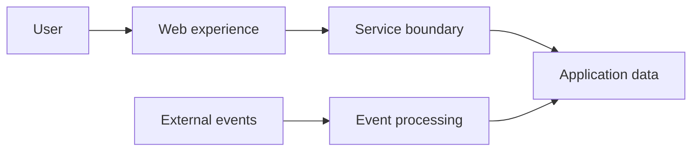

# ForexSpider — showcase

**A private market-platform project, represented here only as a public portfolio case study.**

ForexSpider demonstrates my approach to building responsive, data-aware products where correctness, observability, and a clear user experience matter.

## Focus

- Product-facing web experience and service boundaries
- Typed contracts and event-aware system design
- Reliable data flows, caching, and delivery automation

## Technology signals

**Next.js · React · TypeScript · Python · FastAPI · PostgreSQL · Redis · Docker**

## Public boundary

This repository intentionally contains no source code, strategies, integrations, endpoints, schemas, credentials, infrastructure, or customer data. It is a concise portfolio overview—not the product or a trading service.

© Chidiebere Offor.
