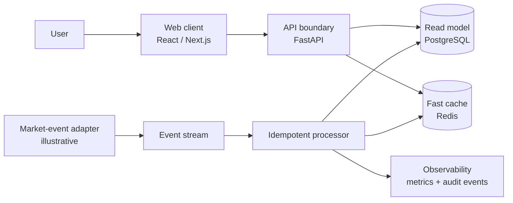

# Architecture notes

## The design question

How can a trading-facing product stay responsive while market data and downstream analysis update asynchronously? The public pattern below separates interactive reads from event processing, keeps contracts explicit, and makes data freshness observable.

## Engineering decisions illustrated

1. **One contract per boundary.** A request or event type is explicit, versionable, and validated before it crosses into domain logic.
2. **Revision-aware updates.** Consumers ignore a duplicate or older event so retries do not corrupt the read model.
3. **Cache as acceleration, not authority.** Persistent data remains the source of truth; Redis supports low-latency reads.
4. **Operations as a feature.** Correlation IDs, freshness timestamps, and health checks make a production system diagnosable.

## Exclusions

No live feed connection, pricing source, broker integration, strategy, execution workflow, production model, endpoint, secret, dataset, or deployment topology is reproduced here. The diagram is intentionally conceptual.
